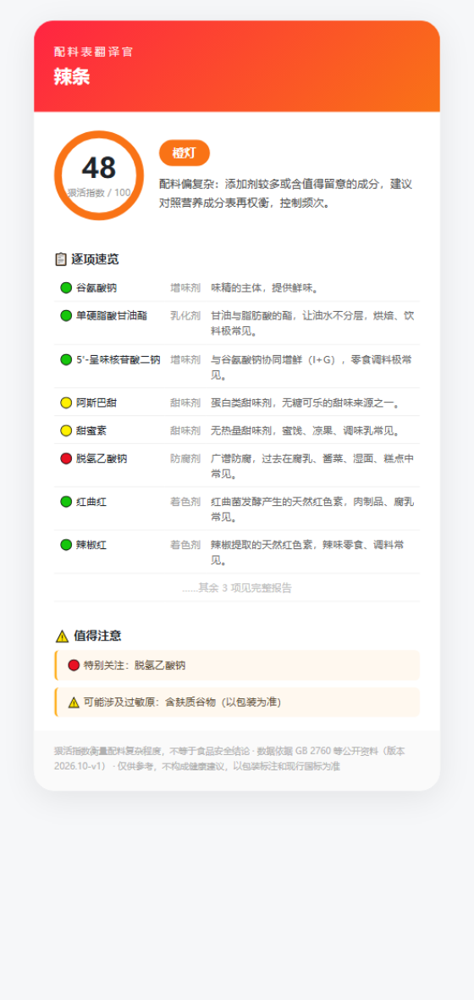

# 配料表翻译官 · Ingredient Translator

把食品包装上的配料表**翻译成人话**的 Agent Skill：每个添加剂是干什么的、糖排第几位、有没有反式脂肪风险、儿童/孕妇/健身人群要注意什么，最后给出一个可复现的「狠活指数」（0–100）。



## 特性

- **确定性判断**：结论来自内置国标（GB 2760）高频数据库 + 固定评分规则，同一配料表永远同一分数，每分可追溯
- **拍照即用**：在支持视觉的 Agent 里直接发配料表照片，Agent 转写后调用脚本；也支持粘贴文字
- **零依赖**：纯 Python 标准库，离线可用，无需 API Key
- **内置自检**：`python scripts/selftest.py` 一条命令验证安装与数据完整性
- **降级可用**：宿主无代码执行能力时，按 `references/quick_reference.md` 速查表近似评估
- **三种输出**：Markdown 完整报告 / JSON 结构化 / HTML 分享卡片
- **合规口径**：不做健康断言，未收录项如实标注，人群提示只引用主流科学共识

## 快速开始

装进任何兼容 [Agent Skills](https://github.com/huaweicloud/huaweicloud-skills) 标准的 Agent 后，对它说：

> 帮我看看这个配料表 + 拍照/粘贴文字

兼容码道 CodeArts、果办 OfficeAce、Claude Code、OpenClaw 等标准宿主；手机端 WorkBuddy 已实测可直接从 GitHub 加载本仓库使用。

或直接运行：

```bash
python scripts/scan.py --text "水、白砂糖、植脂末（葡萄糖浆、氢化植物油）" --name "某乳饮料"
python scripts/scan.py --text "……" --html 报告卡片.html   # 生成分享卡片
python scripts/selftest.py                                  # 自检：三层校验应全部通过
```

## 目录

```
├── SKILL.md                  # Agent 指令入口（触发条件/工作流/口径红线）
├── CHANGELOG.md              # 版本迭代日志
├── scripts/scan.py           # 主入口：解析→查询→评分→报告
├── scripts/label_parser.py   # 配料表解析（括号感知/复合配料展开/别名归一）
├── scripts/selftest.py       # 自检：数据库完整性/解析金样本/评分回归
├── references/additives.json # 360 条国标高频添加剂 + 过敏原/红旗配置
├── references/scoring_rules.md # 狠活指数评分规则（可解释性）
├── references/quick_reference.md # 无脚本降级速查表（自动生成）
├── templates/report_card.html  # HTML 卡片模板
└── demo/                     # 示例配料表与卡片
```

## 评分速览

| 分数 | 灯档 | 含义 |
|---|---|---|
| 0–20 | 🟢 绿灯 | 配料简单干净 |
| 21–45 | 🟡 黄灯 | 常规工业化水平 |
| 46–70 | 🟠 橙灯 | 偏复杂，建议权衡频次 |
| 71–100 | 🔴 红灯 | 添加剂密集/含反式脂肪、高糖红旗 |

> 狠活指数衡量配料复杂程度，不等于食品安全结论；数据依据 GB 2760 等公开资料整理，仅供参考，不构成健康建议。

---

参赛作品 · 2026 华为开发者大赛·小红书 Skill 创新赛（#小红书Skill创新赛 #2026华为开发者大赛）
